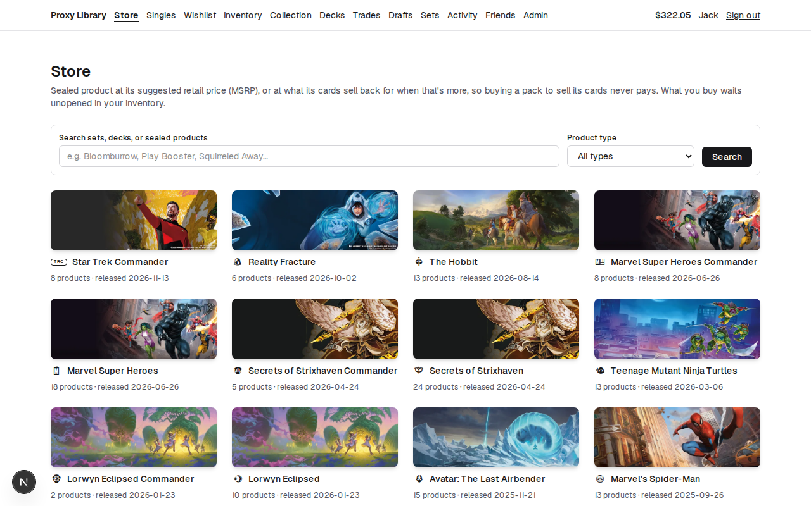
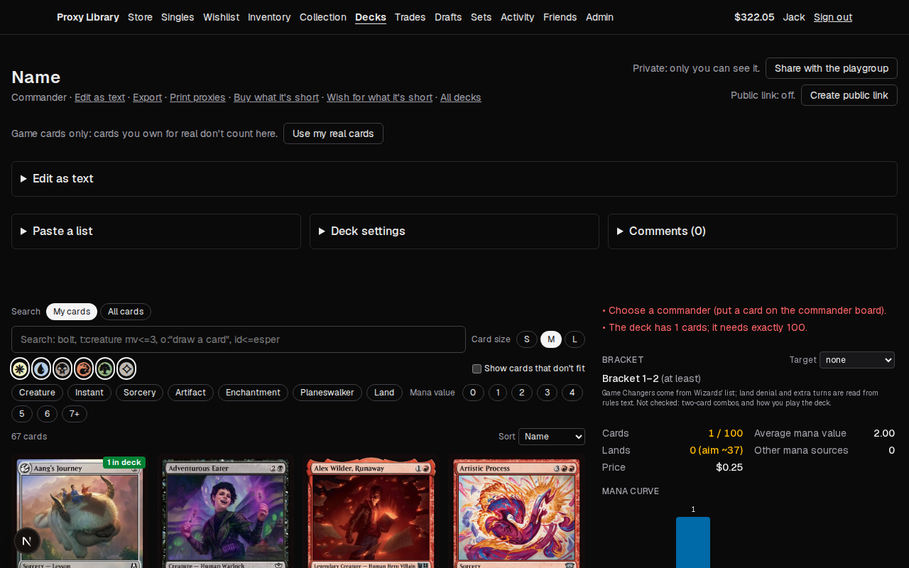
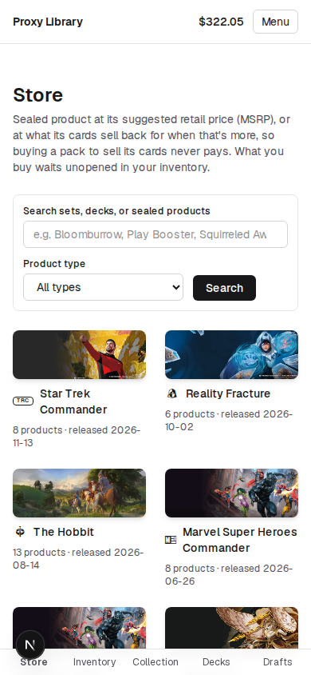
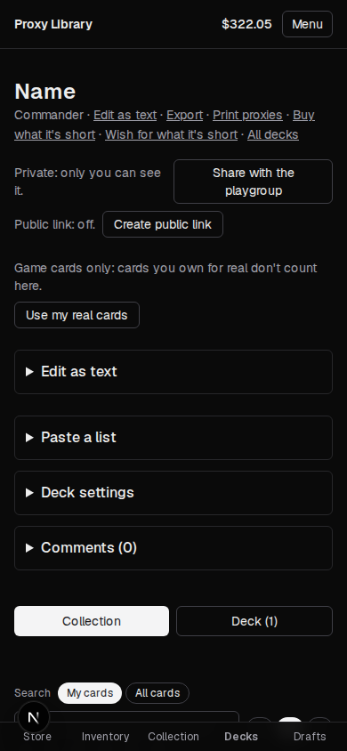
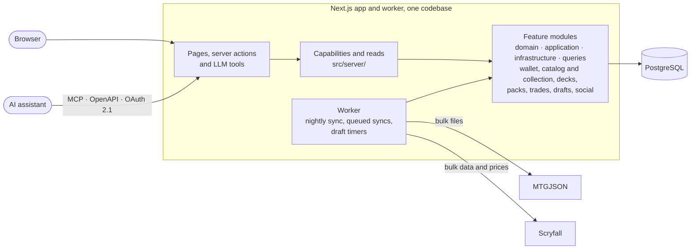

# Proxy Library

A self-hosted web app for a Magic: The Gathering playgroup—combining a virtual sealed/singles economy, collection tracker, deck builder, proxy PDF generator, live booster drafts, and AI deck-building tools. **Everything uses play money and prints proxies for casual play; it is not a real store.**

Licensed under [0BSD](LICENSE) · [Contributing](CONTRIBUTING.md) · [Code of conduct](CODE_OF_CONDUCT.md)

---

## Screenshots

| Desktop (Light — Store)                                               | Desktop (Dark — Deck Builder)                                              |
| --------------------------------------------------------------------- | -------------------------------------------------------------------------- |
|  |  |

| Phone (Light — Store)                                                                          | Phone (Dark — Deck Builder)                                                                         |
| ---------------------------------------------------------------------------------------------- | --------------------------------------------------------------------------------------------------- |
|  |  |

---

## Features

- **Playgroup economy & sealed store** — A recurring play-money allowance (a payday every few days, set by the admin) tracked in an append-only ledger, sealed product priced at official MSRP, and pack opening with realistic odds from real booster recipes, animations, foils, and synthesized sound.
- **Collection, singles & trading** — Track owned cards at exact printing × finish granularity (plus a separate tracker for your real physical collection), buy and sell singles at market price, manage a wishlist, and trade cards and money with other players.
- **Deck builder & analysis** — Build decks from your virtual collection, your real collection, or the entire Magic catalog. Includes a Scryfall-style search language, Commander legality & bracket checks, role tags, hypergeometric draw odds, synergy/budget suggestions, and a whole-deck optimizer.
- **Proxy PDFs** — Generate print-ready proxy sheets (including double-faced cards, tokens, and playtest proxies) with cutting guides.
- **Live drafts** — Draft together in real time (including Conspiracy drafts) with bot seats and Server-Sent Events.
- **Social & sharing** — Share decks and scorecards with the playgroup (or via public links), comment on decks, and browse an activity feed of notable pulls and trades. Installable as a PWA on mobile.
- **LLM & MCP integration** — Built-in MCP server, OpenAPI endpoints, and OAuth 2.1 support so AI assistants can search your collection, audit decks, draw sample hands, and suggest upgrades—backed by local ONNX text embeddings (`pgvector`), Commander Spellbook combos, and EDHREC data.

Card data is synced nightly from [MTGJSON](https://mtgjson.com) and [Scryfall](https://scryfall.com), with official product imagery from Wizards Play Network.

---

## Quick start

**Development** (Nix and direnv provide Node 22, pnpm and Postgres 17 with pgvector from `flake.nix`):

```sh
direnv allow
pnpm install
pnpm hooks:install    # optional: a pre-commit hook (Prettier, typecheck, lint)
pnpm dev:all          # starts a project-local Postgres, migrates, runs the app and the worker
```

Open http://localhost:3000. The first account you register becomes the admin. The worker starts
the first catalog sync within a minute (it downloads Scryfall's card data, about 80 MB, and
MTGJSON's files); watch it under **Admin → Catalog**. Without Nix, see [CONTRIBUTING.md](CONTRIBUTING.md).

**For a playgroup** (Docker Compose, one image for the app and the worker, next to Postgres):

```sh
cp .env.example .env  # set AUTH_SECRET, APP_URL and POSTGRES_PASSWORD
docker compose up -d --build
```

The full guide is [docs/deploy.md](docs/deploy.md).

---

## How it fits together



The pages, actions and tools never reach into a module's internals: they go through the
capabilities and reads in `src/server/`, which are wired once per entry point. The app and the
worker are two entry points into the same modules. Details, the module list and the layer rules
are in [docs/architecture/overview.md](docs/architecture/overview.md).

## Architecture & Engineering Practices

The codebase is structured as a **modular monolith** with ports & adapters around a functional core:

| Practice                                                       | Where to look                                                                                                 |
| -------------------------------------------------------------- | ------------------------------------------------------------------------------------------------------------- |
| Modular monolith, ports & adapters, functional core            | [docs/architecture/overview.md](docs/architecture/overview.md), [ADR 0001](docs/adr/0001-modular-monolith.md) |
| Architecture boundaries enforced by ESLint                     | [ADR 0009](docs/adr/0009-lint-enforced-boundaries.md), `eslint.config.mjs`                                    |
| Expected failures as values (`Result`), not exceptions         | [ADR 0003](docs/adr/0003-result-types.md)                                                                     |
| Money as integer cents in an append-only ledger with row locks | [ADR 0004](docs/adr/0004-append-only-ledger.md), [lesson 03](lessons/03-wallet-ledger-and-time.md)            |
| Cross-module transactions (Unit of Work)                       | [ADR 0005](docs/adr/0005-unit-of-work.md), [lesson 06](lessons/06-transactions-across-modules.md)             |
| External data behind anti-corruption layers                    | [ADR 0007](docs/adr/0007-external-data-acl.md), [lesson 04](lessons/04-pulling-in-outside-data.md)            |
| Replayable randomness (injected RNG & clock)                   | [ADR 0008](docs/adr/0008-injected-rng-clock.md), [lesson 05](lessons/05-randomness-you-can-trust.md)          |
| Shared card search language (parser → AST → parameterized SQL) | [ADR 0017](docs/adr/0017-shared-card-search.md), [lesson 14](lessons/14-a-search-language-and-paper.md)       |
| Unified LLM tool registry (MCP + OpenAPI + OAuth 2.1)          | [ADR 0022](docs/adr/0022-llm-tool-api.md), [lesson 28](lessons/28-tools-for-a-model.md)                       |
| Reproducible dev environment (Nix flakes + direnv)             | [ADR 0010](docs/adr/0010-nix-dev-environment.md)                                                              |

**Testing** is layered by cost: fast unit and property tests (`fast-check`) over pure domain logic and in-memory fakes, integration tests against a real PostgreSQL instance, and end-to-end browser tests with Playwright. Automated tests never hit the network; external APIs use recorded fixtures, with an opt-in `pnpm test:remote` suite and worker data-integrity checks (`check-packs`, `check-products`, `check-commanders`).

---

## Tech Stack

- **Language & Framework:** TypeScript · Next.js 16 (App Router, Server Actions) · React 19 · Tailwind CSS
- **Database & Search:** PostgreSQL 17 with `pgvector` · Drizzle ORM
- **Auth & Validation:** Better Auth · Zod
- **AI & PDF:** `@huggingface/transformers` (local ONNX embeddings) · `@modelcontextprotocol/sdk` · `pdf-lib`
- **Testing & Tooling:** Vitest · fast-check · Playwright · ESLint (`eslint-plugin-boundaries`) · Prettier
- **Dev & Deploy:** Nix flakes + direnv (development) · Docker Compose (production)

---

## How this was built

This project is primarily implemented by AI coding assistants. It started as a hands-on way for a Python/SQL developer to learn TypeScript and team software engineering practices, and has since grown into a full-featured playgroup app. I set the requirements and scope, **review and approve every design document** before implementation begins, test against real data with my playgroup, and run the server—while delegating the specific engineering decisions and implementation details.

Every significant feature follows the process in [docs/roadmap.md](docs/roadmap.md):

1. **Design document** ([`docs/design/`](docs/design/)) — Written before implementation, ending with open questions and trade-offs.
2. **Approval gate** — I review and approve every design document before code is written.
3. **Implementation & verification** — Domain logic first (pure functions + property tests), then application use cases with in-memory fakes, infrastructure adapters with Postgres integration tests, and UI.
4. **Documentation** — Cross-cutting choices are recorded as Architecture Decision Records ([`docs/adr/`](docs/adr/README.md)), and concepts are captured in companion lessons ([`lessons/`](lessons/README.md)).

What I handle directly:

- **Product direction & scope** — Deciding what the app should do and what stays out of scope ([roadmap](docs/roadmap.md), [future ideas](docs/future-ideas.md)).
- **Design approval** — Reviewing every design doc and answering its open product/UX questions.
- **Real-world testing** — Using the app with my playgroup and feeding back issues (pack collation bugs, Commander edge cases, proxy layout readability).
- **Hosting & operations** — Running it on a home server with Docker Compose, Portainer, and nightly backups.

---

## Status & Limits

This is a **personal playgroup project, not a commercial product**. It serves an invite-only playgroup on a home server and has not been load-tested or security-audited for the open internet.

---

## Repository Tour

| Path                                               | What's there                                                                                                                                                                                                                                                                                                                                                         |
| -------------------------------------------------- | -------------------------------------------------------------------------------------------------------------------------------------------------------------------------------------------------------------------------------------------------------------------------------------------------------------------------------------------------------------------- |
| [`src/modules/`](src/modules/)                     | Feature modules, each layered into `domain`, `application`, `infrastructure`, `queries`, and `testing` with a public `index.ts` (accounts, wallet, catalog, packs, inventory, collection, store, decks, trades, drafts, wishlist, social, activity, reset, and the research gateways). The list is in [docs/architecture/overview.md](docs/architecture/overview.md) |
| [`src/app/`](src/app/)                             | Next.js pages, API routes (including MCP/OAuth), and server actions                                                                                                                                                                                                                                                                                                  |
| [`src/server/`](src/server/), [`worker/`](worker/) | Composition roots for the web app and background worker, and the capabilities and reads that pages and tools use                                                                                                                                                                                                                                                     |
| [`docs/`](docs/README.md)                          | Architecture docs, design docs, ADRs, roadmap, and deployment guide                                                                                                                                                                                                                                                                                                  |
| [`lessons/`](lessons/README.md)                    | Companion TypeScript & software design lessons with a [glossary](lessons/GLOSSARY.md)                                                                                                                                                                                                                                                                                |
| [`scripts/`](scripts/)                             | `dev/` (the `pnpm check` gate, database, ratchets) and `ops/` (deploy, backup)                                                                                                                                                                                                                                                                                       |
| [`tests/`](tests/)                                 | Integration tests, Playwright E2E tests, and recorded fixtures                                                                                                                                                                                                                                                                                                       |

---

## Common commands

| Command                                     | Does                                                                                       |
| ------------------------------------------- | ------------------------------------------------------------------------------------------ |
| `pnpm dev:all`                              | Database + migrations + app + worker in one terminal                                       |
| `pnpm hooks:install`                        | Installs the pre-commit hook (the fast part of `pnpm check`)                               |
| `pnpm check`                                | The pre-commit gate: typecheck, lint, cycles, format, unit tests, size/clone/knip ratchets |
| `pnpm test:int`                             | Integration tests against the `tcg_test` database                                          |
| `pnpm test:e2e`                             | Browser tests (Playwright)                                                                 |
| `pnpm test:remote`                          | Opt-in tests against live MTGJSON/Scryfall endpoints                                       |
| `pnpm worker schedule`                      | Nightly catalog sync, queued syncs, and draft timers                                       |
| `pnpm worker check-packs`                   | Opens 1,000 packs of every booster recipe and reports rule violations                      |
| `pnpm worker check-products`                | Verifies every product for sale has contents                                               |
| `pnpm worker check-commanders`              | Verifies every precon's commander is Commander-legal                                       |
| `pnpm worker sync [prices\|full\|features]` | Runs a catalog sync (or just the card-feature pass) now                                    |
| `pnpm worker embed-cards`                   | Generates local text embeddings for semantic card search                                   |

---

## Legal

The code is licensed under [0BSD](LICENSE). Please read the [code of conduct](CODE_OF_CONDUCT.md) too: it states what I hope the project is used for.

Proxy Library is unofficial Fan Content permitted under the Wizards of the Coast [Fan Content Policy](https://company.wizards.com/en/legal/fancontentpolicy). Not approved or endorsed by Wizards. Portions of the materials used are property of Wizards of the Coast. ©Wizards of the Coast LLC. This project is free and has no affiliation with Wizards of the Coast, MTGJSON, or Scryfall. Proxies printed by it are for casual play only, not for sale.
