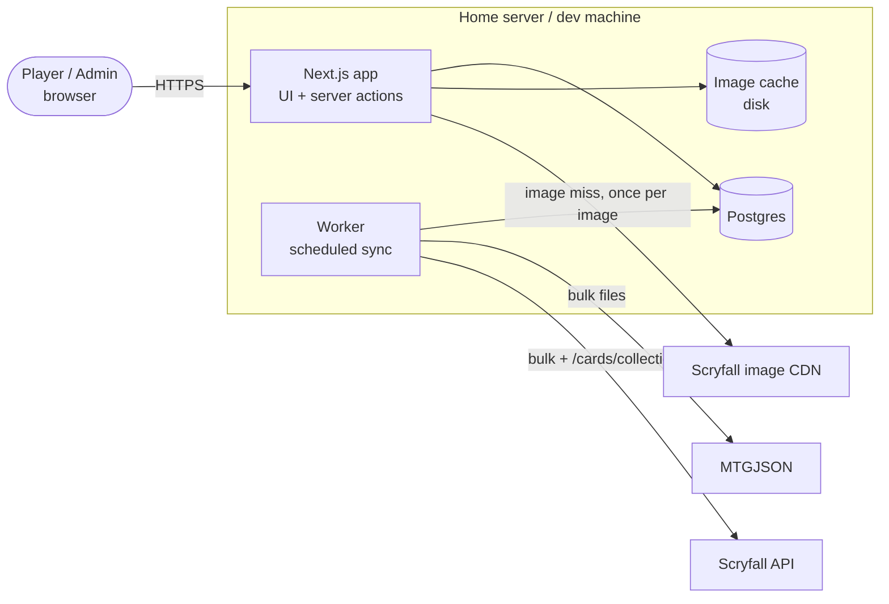
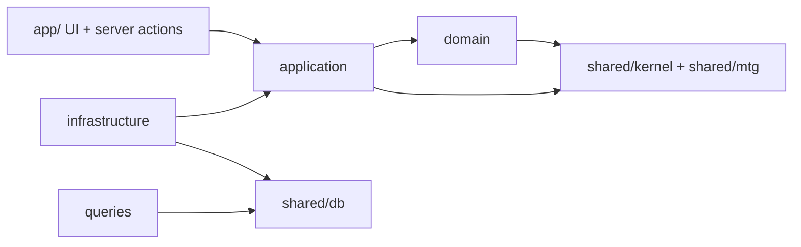
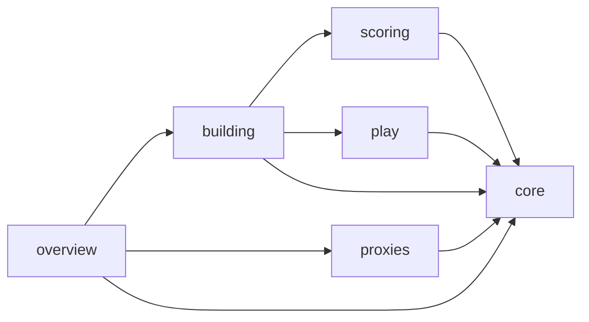
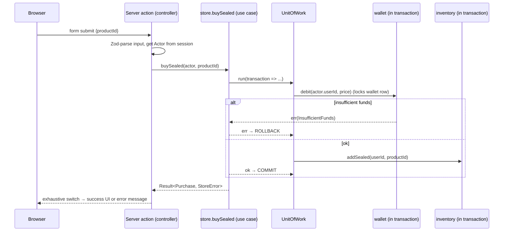

# Architecture overview

> Status: **accepted** (2026-09-26). Decisions are recorded as ADRs in [`../adr/`](../adr/).

## Goals, in priority order

1. **Correctness of money and ownership.** No double spends, no duplicated or lost cards, no
   client-side tampering with pack contents.
2. **Easy to change.** Each feature lives in one place, and swapping a data source or DB adapter
   touches one folder.
3. **Testable without infrastructure.** Core rules (pack odds, allowance, deck legality, trade
   validation) are tested as pure functions in milliseconds.
4. **Legible for a learner.** The structure teaches good design instead of hiding it behind magic.
5. **Not over-engineered.** Every abstraction must pay for itself (see "When _not_ to add an
   abstraction" in [patterns.md](patterns.md#when-not-to-add-an-abstraction)).

## Style in one sentence

A **modular monolith**: one deployable app, split into **feature modules**. Each module is
internally layered as **ports & adapters** around a **functional core**. The pieces are wired
together by **factory functions** in a single **composition root**.

## System context



The app and worker are **two entry points into the same modules**, each with its own composition
root.

## Modules (bounded contexts)

| Module       | Owns                                                                                                                                                                                                                                     | Kind                              |
| ------------ | ---------------------------------------------------------------------------------------------------------------------------------------------------------------------------------------------------------------------------------------- | --------------------------------- |
| `accounts`   | users, roles, permissions (`canSelfFund`), sessions (via Better Auth), `Actor`                                                                                                                                                           | adapter-heavy, thin domain        |
| `wallet`     | append-only ledger, balance, allowance accrual, grants, self-funding, public stats                                                                                                                                                       | **reference module**, rich domain |
| `catalog`    | **cards**: sets, **printings**, prices per finish with **daily price history** (ADR 0013), booster configs, sealed products, images. **rules**: the Comprehensive Rules. **outside**: EDHREC, Commander Spellbook, embeddings (ADR 0030) | read-mostly; sync = ACL           |
| `packs`      | pack generation engine: booster config + Rng → cards                                                                                                                                                                                     | **pure library**, no I/O          |
| `inventory`  | owned sealed product, its lifecycle (unopened → opened), opening                                                                                                                                                                         | domain + persistence              |
| `collection` | **game**: owned cards at exact **printing × finish** (ADR 0011) + acquisition log. **real**: cards and sealed products a player owns physically (design doc 16). **copies**: the SQL both share (ADR 0030)                               | domain + persistence              |
| `store`      | buying sealed and singles, selling singles to the store, the **store transaction ledger** (ADR 0013): orchestrates wallet + inventory + collection                                                                                       | orchestration only                |
| `decks`      | decks, ownership check, format legality, export formats; also sharing, snapshots, suggestions, building, the simulator and proxy sheets, as eight areas (below, ADR 0029)                                                                | rich domain                       |
| `trades`     | proposals, trade lifecycle, atomic execution                                                                                                                                                                                             | rich domain + orchestration       |
| `activity`   | feed of domain events ("X opened a mythic")                                                                                                                                                                                              | read model                        |
| `reset`      | an admin empties a player's library: asks each module to clear its part, in one transaction                                                                                                                                              | orchestration only (no tables)    |
| `drafts`     | live booster drafts: lobbies, entry fees, packs passed around the table, pick timers, a deck for each player at the end                                                                                                                  | rich domain + orchestration       |
| `research`   | outside research for the LLM tools: Reddit threads and posts (`reddit`), YouTube transcripts and videos (`youtube`) (ADR 0030)                                                                                                           | adapters over outside services    |
| `wishlist`   | cards a player wants, any printing or one exact printing (design doc 26): today's best offer, affordability, buying through the store                                                                                                    | domain + persistence              |

### Module dependency graph (allowed directions only)

```mermaid
flowchart TD
  store --> wallet & inventory & collection & catalog
  trades --> wallet & collection
  inventory --> packs & collection & catalog
  decks --> catalog_types
  collection --> catalog_types
  packs --> catalog_types[catalog types only]
  wallet --> accounts
  store & trades & inventory & decks --> accounts
  store & trades & inventory --> activity[activity: recordEvent in the same transaction]
  reset --> trades & wallet & inventory & collection & decks & activity & drafts & wishlist
  wishlist --> store
  drafts --> wallet & collection & decks & packs & activity
  drafts -. pack price .-> store
  collection_real[collection/real] --> catalog_types
  catalog -. ExtraPricedPrintings port, filled in core.ts .-> collection_real
```

As built (2026-09-28): modules share each other's **types** freely (`import type`), and call each
other's **functions that run inside the caller's transaction** (`spend`, `receiveItems`,
`receiveCards`, `giveUpCards`, `recordEvent`). Read models may read any module's tables. Opening
a precon creates a deck from the app layer (the open action calls `decks.createDeckFromCards`),
so inventory doesn't depend on decks.

Rules: the graph is **acyclic**. Modules depend on each other **only through their public
`index.ts`**. `catalog` and `accounts` depend on no other feature module.

## Inside a module: layers

```
src/modules/wallet/
  domain/           pure types + pure functions + error types. No I/O, no framework imports.
  application/      use cases (factory functions) + ports (interfaces they need)
  infrastructure/   adapters implementing ports: Drizzle repos, API clients, schema tables
  queries/          read models for the UI (CQRS-lite): SQL in, plain view objects out
  testing/          in-memory fakes of this module's ports, for other tests to reuse
  index.ts          PUBLIC API: the only file other modules / the UI may import
```

The **dependency rule** points inward:



- `domain` imports only `shared/kernel` and `shared/mtg`. Its code can run in a unit test without anything else.
- `application` defines the **ports** it needs (`LedgerRepo`, `Clock`, …) and depends on those
  interfaces, never on Drizzle.
- `infrastructure` implements the ports. It's the only layer that knows about Postgres or HTTP.
- Only the **composition root** (`src/server/composition/container.ts`, `worker/container.ts`) imports
  `infrastructure` and wires it into use cases.

This is enforced by lint (ADR [0009](../adr/0009-lint-enforced-boundaries.md)).

### Inside `decks`: areas

`decks` is one module split into **areas**, each with the usual layer folders and its own public
API (ADR [0029](../adr/0029-split-decks.md)). A file imports another area only through its
`index.ts` or `client.ts` (lint rule in `eslint.config.mjs`; the cycle check treats each area as a
node), and only along these arrows:



| Area       | Holds                                                                                      |
| ---------- | ------------------------------------------------------------------------------------------ |
| `core`     | the deck, lists, legality, formats, brackets, headings, stats                              |
| `sharing`  | public links, who may read a deck, comments                                                |
| `changes`  | edit previews, snapshots and restoring them, builder moves                                 |
| `scoring`  | `rate`, `signals`, `suggest`, `cuts`, `swaps`, `replacements`, `optimize`                  |
| `building` | `build-from-collection`, `mana-base`, commanders, candidate pool, suggestion orchestration |
| `play`     | opening hands, goldfish, odds, castability                                                 |
| `proxies`  | proxy sheets, playtest cards, token proxies, the PDF renderer                              |
| `overview` | the reads that combine areas: deck overview and facts, snapshot comparison, the optimizer  |

The module root keeps `index.ts` and `client.ts` (each is `export *` of the areas'), `wiring.ts`
and `infrastructure/index.ts` (the real adapters, for the composition roots).

### Inside `catalog`, `collection` and `research`: areas

The same rule (ADR [0030](../adr/0030-merge-collections-split-catalog.md)): each area has the
layer folders and its own `index.ts`, and imports another area only through it, along these arrows.
The module root keeps `index.ts` (`export *` of the areas), `wiring.ts` and `infrastructure/index.ts`;
`catalog` also has `make-catalog.ts`, which joins the areas' use cases.

| Module       | Areas (arrows)                                                                                                    |
| ------------ | ----------------------------------------------------------------------------------------------------------------- |
| `catalog`    | `cards` → `outside`; `rules` → `outside`; `outside` imports none                                                  |
| `collection` | `game` → `copies`; `real` → `copies`; `copies` imports none. `real` has its own door, `@/modules/collection/real` |
| `research`   | `reddit`, `youtube`: no arrows                                                                                    |

**Real cards never touch the game's money** (design doc 16, rule 1). `collection/real` is not
exported by the module's `index.ts`: only the app, the composition roots and the tests may import
it, `real` imports no game area, and lint stops it importing any module but `accounts` and
`catalog`, so never the wallet or the store.

## Outside the modules: the adapters and the composition roots

| Path                      | Holds                                                                                                                      |
| ------------------------- | -------------------------------------------------------------------------------------------------------------------------- |
| `src/app/`                | Next.js routes: pages, server actions and API routes. Thin adapters over the capabilities (ADR 0026)                       |
| `src/app/_components/`    | Components that know the app (menus, navigation, card filters, the PWA); a page's own components sit in its route folder   |
| `src/app/_llm-tools/`     | The LLM tools (design doc 28): `bindings/` has one file per tool, named after it; `present/` shapes their answers          |
| `src/ui/`                 | The general building blocks every page uses (buttons, fields, forms, dialogs, page states); no data access                 |
| `src/ui/mtg/`             | Magic's displays: card images and views, mana, set symbols, prices and sealed products                                     |
| `src/server/`             | The request helpers adapters use: `readPage()`, `action()`, `formAction()`, `readTool()`, the session                      |
| `src/server/composition/` | The app's composition root (`container.ts`), the wiring shared with the worker (`core.ts`), and the capabilities it builds |
| `src/proxy.ts`            | The sign-in guard that runs before every request (Next 16's middleware)                                                    |
| `worker/`                 | The background worker: its composition root (`container.ts`) and its commands (`commands/`)                                |

## Cross-cutting pieces (`src/shared/`)

| Path                  | Contents                                                                                                                                          |
| --------------------- | ------------------------------------------------------------------------------------------------------------------------------------------------- |
| `shared/kernel/`      | `Result`, `Brand`, `UserId`, `Cents`, `Clock` + `Rng` ports, weighted sampling, `UnitOfWork` port, `assertNever`. Test fakes in `kernel/testing/` |
| `shared/mtg/`         | Magic's vocabulary: finishes, rarities and colours (with their Zod schemas), card types, the mana curve, tags and signals, plain rules text       |
| `shared/card-search/` | The card search language and list reader (ADR 0017): pure, so the browser may use it. Its SQL lives in `catalog`                                  |
| `shared/db/`          | Drizzle client factory, `DbExecutor` type, `UnitOfWork` implementation, migration runner                                                          |
| `shared/runtime/`     | Real OS-backed adapters for kernel ports: `systemClock`, `randomSeed`                                                                             |
| `shared/config/`      | Zod-parsed environment. The only place that reads `process.env`.                                                                                  |
| `shared/http/`        | (Phase 4) `fetchJson` + composable decorators (`withRateLimit`, `withRetry`, `withUserAgent`)                                                     |

The kernel is deliberately **tiny and stable**: general basics only. Magic's words live next to it in
`shared/mtg`, which the lint rules treat as part of the kernel. It isn't a `utils/` dumping ground.

## Anatomy of a write request

Example: _buy a Play Booster_.



The controller does **three things only**: parse input, identify the actor, and map the `Result`
to UI. No business rules live in `app/`.

## Anatomy of a read request

A page calls `readPage()` (the session and the actor), then `reads.<module>.<query>(actor, ...)`:
`reads` is each module's query functions with the database filled in (`src/server/composition/reads.ts`).
One SQL query returns plain serializable view objects, and the page renders them. A read that
shows one player's data takes the `Actor` and filters by it in SQL. Anything with rules, or any
write, goes through a **capability** instead (`capabilities.decks.listDecks(actor, input)`),
and the same capability serves the page, a server action and an LLM tool binding: those are the
adapters, and each only parses input, calls, and presents (ADR 0026). Reads skip repositories and
use cases on purpose (ADR [0006](../adr/0006-cqrs-lite-reads.md)).

## Where state and nondeterminism live

| Concern        | Home                                                                            |
| -------------- | ------------------------------------------------------------------------------- |
| Money          | `ledger_entries` (append-only). Balance is always derived.                      |
| Card ownership | `collection` quantities + `acquisitions` log                                    |
| Randomness     | `Rng` port, created server-side per opening. Seeded in tests.                   |
| Time           | `Clock` port. Fixed in tests.                                                   |
| External data  | Only in `catalog/infrastructure` (ACL). Translated to domain types at the edge. |
| Config         | `shared/config/`, passed in by the composition root                             |
| Sessions       | `accounts/infrastructure` (Better Auth) → exposes `getActor()`                  |

## Deployment view

- **Dev (now):** NixOS, flake + direnv, socket-only Postgres in `.dev/`, `pnpm dev`, `pnpm worker`.
- **Prod (Phase 11):** Docker Compose with `app`, `worker` and `db` containers, plus volumes for
  Postgres and images. The code doesn't change because all config comes from env vars.
