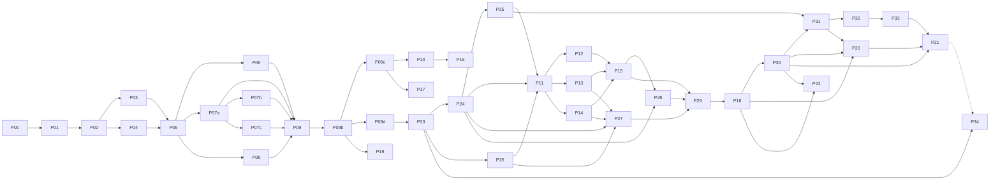

# Refactor status

> Read [README.md](README.md) first. Update this file at the start and end of every session (on
> `refactor/main`). Statuses: **free**, **in progress (session name)**, **done**, **blocked
> (reason)**.

## Packages

Waves run in order. Inside a wave, packages marked parallel can run at the same time, each in
its own worktree. The order was revised by the [plan review](reviews/plan-review/README.md)
(2026-11-19, approved by the owner). Every new package lists what it **deletes**. Once P23 adds
`sizes-baseline.txt`, a package that doesn't lower it needs the owner's approval.

| Id    | Package                                                                                                 | Depends on                    | Parallel with      | Status                                                                                 |
| ----- | ------------------------------------------------------------------------------------------------------- | ----------------------------- | ------------------ | -------------------------------------------------------------------------------------- |
|       | **Wave 0: set up**                                                                                      |                               |                    |                                                                                        |
| P00   | [Set up the refactor](packages/P00-setup.md)                                                            | none                          | none               | done                                                                                   |
| P01   | [Delete dead code](packages/P01-dead-code.md)                                                           | P00                           | none               | done                                                                                   |
|       | **Wave 1: the basics** (audit R2)                                                                       |                               |                    |                                                                                        |
| P02   | [One set of basic types; money](packages/P02-basic-types.md)                                            | P01                           | none               | done                                                                                   |
| P03   | [One current-price query](packages/P03-current-price.md)                                                | P02                           | P04                | done                                                                                   |
| P04   | [One card-type helper](packages/P04-card-types.md)                                                      | P02, decision 1               | P03                | done                                                                                   |
|       | **Wave 2: capabilities and adapters** (audit R3) · milestone 1                                          |                               |                    |                                                                                        |
| P05   | [Capability and binding framework](packages/P05-framework.md)                                           | P03, P04                      | none               | done                                                                                   |
| P06   | [Deck read capabilities](packages/P06-deck-reads.md)                                                    | P05                           | P07, P08           | done                                                                                   |
| P07a  | [Shared SQL pieces: text arrays, store offers](packages/P07-candidates.md)                              | P05                           | P06, P08           | done                                                                                   |
| P07b  | [Candidate pool (SQL)](packages/P07b-candidate-pool.md)                                                 | P07a                          | P08                | done                                                                                   |
| P07b2 | [Suggestion service](packages/P07b2-suggestion-service.md)                                              | P07b                          | P08                | done                                                                                   |
| P07c  | [Card and wishlist tools as bindings](packages/P07c-library-tools.md)                                   | P07a                          | P08                | done                                                                                   |
| P07d  | [search_cards as a binding](packages/P07d-search-cards.md)                                              | P07b, P07c                    | P08                | done                                                                                   |
| P08   | [Deck edits and previews](packages/P08-edits-previews.md)                                               | P05                           | P06, P07           | done                                                                                   |
| P09   | [Remaining tools and error text](packages/P09-remaining-tools.md)                                       | P06, P07a–d, P07b2, P08       | none               | done                                                                                   |
|       | **Wave 2½: UI callers onto capabilities** ([milestone 1 review](reviews/milestone-1.md))                |                               |                    |                                                                                        |
| P09b  | [Capability wiring per module; builder actions](packages/P09b-wiring-and-builder.md)                    | P09                           | none               | done                                                                                   |
| P09c  | [Deck, draft and collection callers](packages/P09c-deck-callers.md)                                     | P09b                          | P09d               | done                                                                                   |
| P09d  | [The other callers](packages/P09d-other-callers.md)                                                     | P09b                          | P09c, wave 3       | done                                                                                   |
|       | **Done from the old waves 3 and 4**                                                                     |                               |                    |                                                                                        |
| P10   | [Formats as a strategy table](packages/P10-formats.md)                                                  | P09c                          | none               | done                                                                                   |
| P16   | [One mana curve](packages/P16-mana-curve.md)                                                            | P10, decision 2               | none               | done                                                                                   |
| P17   | [One way to show a collection](packages/P17-collections.md)                                             | P09c                          | none               | done                                                                                   |
| P19   | [Break up the deck builder UI](packages/P19-builder-ui.md)                                              | P09b                          | none               | done                                                                                   |
|       | **Wave 3a: clear the ground** (plan review) · before any card-features code                             |                               |                    |                                                                                        |
| P23   | [Guards and test fixes](packages/P23-guards-and-test-fixes.md)                                          | none                          | none               | done                                                                                   |
| P24   | [Delete dead code and the interactive goldfish](packages/P24-dead-code.md)                              | P23                           | P26                | done                                                                                   |
| P25   | [The read layer, secure by construction](packages/P25-read-layer.md)                                    | P23, P24                      | P26                | done                                                                                   |
| P26   | [Shared card and row types](packages/P26-shared-types.md)                                               | P23                           | P24, P25           | done                                                                                   |
|       | **Wave 3b: card features, by ability**                                                                  |                               |                    |                                                                                        |
| P11   | [Card features: model and store](packages/P11-card-features.md)                                         | P25, P26, decision 3          | none               | done                                                                                   |
| P12   | [Mana and casting, by ability](packages/P12-mana-casting.md)                                            | P11                           | P13, P14           | done (absorbed by P11; its one real slice, enters-tapped, moves to P14)                |
| P13   | [Tags, themes and signals, by ability](packages/P13-tags-signals.md)                                    | P11                           | P12, P14           | done                                                                                   |
| P14   | [Lands, tokens and draft cards, by ability](packages/P14-lands-drafts.md)                               | P11                           | P12, P13           | done                                                                                   |
|       | **Wave 4: one engine per job** · milestone 2                                                            |                               |                    |                                                                                        |
| P15   | [One opening-hand and one mana-payment engine](packages/P15-opening-hands.md)                           | P12, P13, P14                 | P27                | done                                                                                   |
| P27   | [One scorer; no scores or ranks in tools](packages/P27-one-scorer.md)                                   | P13, P14, P24, P26            | P15                | done                                                                                   |
| P28   | ["Can I cast X by turn Y?": simulator and effect registry](packages/P28-cast-by-turn.md)                | P15, P24                      | P27                | done                                                                                   |
|       | **Wave 5: structure** · milestone 3                                                                     |                               |                    |                                                                                        |
| P29   | [Untangle the import cycles](packages/P29-untangle-cycles.md)                                           | P15, P27, P28                 | none               | done                                                                                   |
| P18   | [Split `decks` into subfolders](packages/P18-split-decks.md)                                            | P29, decision 4               | none               | done                                                                                   |
| P30   | [Merge the collections; split `catalog`](packages/P30-collections-and-catalog.md)                       | P18, P29                      | none               | done                                                                                   |
|       | **Wave 6: what a professional sees** · final milestone                                                  |                               |                    |                                                                                        |
| P31   | [UI building blocks and colour tokens](packages/P31-ui-building-blocks.md)                              | P25, P30                      | P34                | done                                                                                   |
| P32   | [Page states and thin pages](packages/P32-page-states-thin-pages.md)                                    | P31                           | P20, P34           | free                                                                                   |
| P33   | [Accessibility pass](packages/P33-accessibility.md)                                                     | P31, P32                      | P20, P34           | free                                                                                   |
| P20   | [Near-clones, large files, split e2e spec, thin worker](packages/P20-large-files.md)                    | P18, P30, P31                 | P22, P32–P34       | free                                                                                   |
| P21   | [Naming sweep, README fact check, trimmed `CLAUDE.md`](packages/P21-naming-docs.md)                     | P18, P20, P30, P33            | P22, P34           | free                                                                                   |
| P22   | [Design docs into `docs/modules/`; citation check](packages/P22-design-docs.md)                         | P18, P30                      | P20, P21, P31–P34  | done                                                                                   |
| P34   | [Repo polish: CI, licence, contributing, README](packages/P34-repo-polish.md)                           | P23 (its CLAUDE.md step: P21) | P20, P22, P32, P33 | steps 1–5 merged; 6–7 wait for the owner (tududi tooling; the lessons repo, after P21) |
| P35   | [Sign-in and connector OAuth through Authentik (a feature)](packages/P35-authentik.md)                  | P25                           | waves 5 and 6      | app side merged; the homelab Authentik setup waits for the owner's OK                  |
| P36   | [Decisions from P22: 60-card role targets, commander score with options](packages/P36-p22-decisions.md) | P22, P30                      | wave 6             | free                                                                                   |

## Size tracking

P00's `pnpm sizes` prints these. Add a row when each wave merges. Targets are from doc 65, "The end
state".

| After                       | Source lines                                                                                                            | Test lines | Files > 500 | Biggest folder | Clone runs     | `getContainer()` in app          |
| --------------------------- | ----------------------------------------------------------------------------------------------------------------------- | ---------- | ----------- | -------------- | -------------- | -------------------------------- |
| Baseline                    | 93,361                                                                                                                  | 32,194     | 28          | 43             | 83             | 191                              |
| P00 script                  | 93,490 \*                                                                                                               | 33,860     | 28          | 43             | 63 \*\*        | 191                              |
| After P04                   | 91,358                                                                                                                  | 34,255     | 27          | 43             | 57             | 191                              |
| After wave 2                | 92,251                                                                                                                  | 35,885     | 23          | 48             | 36             | 191                              |
| After wave 2½               | 92,379 (79,270 code)                                                                                                    | 36,098     | 21          | 49             | 36             | 4 (2 files, allowed)             |
| After P23 (new count)       | 77,318 production code lines; test support 2,345; tests 32,905                                                          | —          | 19          | —              | 25 (near: 229) | 4 (2 files, allowed)             |
| After P24 and P26           | 74,789 production code lines                                                                                            | —          | —           | —              | —              | knip 457                         |
| After P25                   | 75,151 production code lines (baseline raised once, owner approved)                                                     | —          | —           | —              | 21             | knip 391                         |
| After P11                   | 75,382 production code lines (P11's approved exception, +231)                                                           | —          | —           | —              | 21             | knip 391; card-text regexes 128  |
| After P12–P14 (wave 3)      | 75,422 production code lines (P14 +37, owner accepted)                                                                  | —          | 14          | —              | —              | knip 383; card-text regexes 99   |
| After P15 and P27           | 75,009 production code lines                                                                                            | —          | —           | —              | —              | knip 382; card-text regexes 96   |
| After P28                   | 75,355 production code lines (owner accepted +346)                                                                      | —          | —           | —              | —              | knip 380                         |
| After waves 5 and part of 6 | 76,920 production code lines (P35 +967, P31 +206, P22 +105 approved)                                                    | —          | —           | —              | —              | knip 212                         |
| **Target**                  | **≤ 75,000 code lines (stretch ≤ 72,000), test support counted separately** (plan review, replaces decision 6's 73,000) | —          | **0**       | **≤ 12**       | **≤ 20**       | **one per file, via `action()`** |

## Milestones (`refactor/main` → `main`, user approves)

Before each milestone, run the checks in [deferred-checks.md](deferred-checks.md) (network, browser
and by-eye checks the packages couldn't do).

| Milestone | After              | Requires                                                                                                                                                                                                                                                                                                                         | Status                                                                                                                      |
| --------- | ------------------ | -------------------------------------------------------------------------------------------------------------------------------------------------------------------------------------------------------------------------------------------------------------------------------------------------------------------------------- | --------------------------------------------------------------------------------------------------------------------------- |
| 1         | Wave 2 + 2½        | full suite green; every LLM tool and builder feature working again; UI callers on capabilities (P09b–d)                                                                                                                                                                                                                          | wave 2 merged into `main` 2026-11-19; wave 2½ reviewed and merged into `main` 2026-11-19 ([review](reviews/milestone-1.md)) |
| 2         | Waves 3a, 3b and 4 | full suite green; `getContainer()` in `src/app` only in `CONTAINER_ALLOWED`; `pnpm check` green with the sizes ratchet and `knip --production`; one engine per job (P15, P27, P28); the Authentik provider and application set up in the homelab and the OIDC env vars added to the stack, at the deploy (P35, owner 2026-11-20) | not reached                                                                                                                 |
| 3         | Wave 5 (structure) | full suite green; no import cycles between modules or `decks` areas; no folder over 12 files; docs for the new layout (`overview.md`)                                                                                                                                                                                            | not reached                                                                                                                 |
| 4 (final) | Wave 6             | full suite green; no file over 500 lines without a reason; UI blocks, page states and accessibility done; README, licence and CI in place; `docs/refactor/` ready to archive (P21 step 9, P34)                                                                                                                                   | not reached                                                                                                                 |

**Remove later:** [removal-list.md](removal-list.md) lists the scaffolding and dead-code candidates left behind, with who removes each. Add to it whenever you leave something.

## Decisions needed (ask the user; record the answer here and on the tududi task)

1. (tududi task 260) **Double-faced cards (P04):** does a spell with a land on its back count as a land for the
   deck's land count, the drafter and test hands? Today the builder says no and the drafter says
   yes. **Answered (2026-11-19): yes.** A double-faced card with a land face counts as a land
   everywhere: the deck's land count, the drafter and test hands.
2. (tududi task 261) **The mana curve (P16):** should everything share one curve (the builder's 0–7+), or should
   the drafter and "draft a deck" keep their own named versions?
   **Answered (2026-11-19): one curve, the builder's.** The drafter and "draft a deck" use the
   builder's mana curve (0–7+). P16 is unblocked.
3. (tududi task 262) **Card features storage (P11):** precompute at sync (needs a backfill) or compute when a deck
   loads and cache it?
   **Answered (2026-11-19), conditional:** precomputing at sync (and on update) is preferred, because
   other tools (similar cards, tags) benefit; compute-on-load avoids stale data and wasted work. P11
   first checks where card features are used: if they are used in many places and in deck building,
   compute at sync and update; otherwise compute on load and cache. Record the finding in P11's
   handoff.
4. (tududi task 263) **Splitting `decks` (P18):** four modules (`decks`, `deck-play`, `deck-advice`, `proxies`), or one `decks/` module with
   four responsibility subfolders, the way `research/` holds `reddit/` and `youtube/`?
   **Answered (2026-11-19): one `decks/` module with four responsibility subfolders.** P18 is
   unblocked.
5. (tududi task 264) **The 27 unregistered tools (P01):** any to bring back as bindings after P09?
   **Answered (2026-11-19): remove them completely, after checking their functions are covered.**
   Checked: `set_deck_entry`, `arrange_headings`, `check_owned`, `deck_facts`, `deck_tokens`,
   `deck_scorecard`, `get_wishlist`, the two YouTube tools, the opening-hand and mulligan tools and
   `idea_candidates` / `idea_budget_upgrades` are covered by `edit_deck`, `get_cards`, `get_deck`,
   `manage_wishlist`, `youtube_research`, `draw_sample`, `search_cards` and `find_replacements`.
   Builder-only (no tool): snapshots and diff, `draft_deck`, `commanders_i_can_build`, `list_sets`,
   the interactive goldfish, `idea_optimize_deck`, `idea_upgrade_roadmap`. Card packages
   (`create_package`, `apply_package`, `list_packages`) were not found in the builder either: check
   in P20 whether that feature still exists or is dead. None come back as tools.

6. (tududi task 266) **The line target:** keep ≤ 80,000 as a stretch goal, or revise it?
   **Answered (2026-11-19): revise it, and count code, not comments.** The user suspected the
   count included documentation. Checked: it counts `.ts` and `.tsx` files only (no Markdown), but
   about 13% of the lines are blank or comment-only (src: 6,454 blank, 6,266 comment-only of 91,161),
   so the raw 80,000 target was about 68,000 lines of code, a far bigger cut than it sounded. In code
   lines (no blanks or comment-only lines, `src` without tests), the baseline was 80,320 and wave 2
   ends at 78,441: the refactor has so far removed about 1,900 lines of code (2%) and added about 260
   lines of comments. `pnpm sizes` now prints **Code lines**. **New target: ≤ 73,000 code lines,
   stretch ≤ 70,000** (today 79,367 by the script, which also counts `worker/` and `scripts/`),
   from the remaining duplication of about 6,800 to 10,500 lines in the
   [dedup playbook](dedup-playbook.md). Raw lines are still printed, no longer a target.

7. (P19, tududi task 256) **A failed builder change:** when a quantity, move, swap or add-lands
   change is refused, the builder keeps its guess and shows the message (as before). A refusal now
   carries the server's deck, so undoing the guess is a one-line change. Undo it, or keep today's
   behaviour?
8. (P19) **Reads that find nothing** ("not found or not yours") show nothing, as before. Should
   any of them show the player an error instead?
9. (P11, tududi task 248) **Design doc 66's ten open questions.** **Answered (2026-11-19):** the
   proposed answer to all ten (one row per oracle card, each face recognized and merged, one ramp
   tag plus a tapped-source feature, rituals are ramp, Scryfall's keywords, themes as the signal
   vocabulary, both token sources, declared and recognized cost reducers, a stored land-cycle
   array, phrase mining reads plain text). On storage the user asked what one row per card would
   lose: nothing. Card text, types, produced mana, keywords and Game Changer status never differ
   between printings; legalities, prices, art and finishes stay per printing. See doc 66,
   section 12.

## Decisions made

| #   | Decision                                                                                                                                                                                                                                                                                                                                                                                                                                                                                                                                                                                                                                                                                                                                                                                                                                                                                                                                                                     | Date       |
| --- | ---------------------------------------------------------------------------------------------------------------------------------------------------------------------------------------------------------------------------------------------------------------------------------------------------------------------------------------------------------------------------------------------------------------------------------------------------------------------------------------------------------------------------------------------------------------------------------------------------------------------------------------------------------------------------------------------------------------------------------------------------------------------------------------------------------------------------------------------------------------------------------------------------------------------------------------------------------------------------- | ---------- |
| —   | Work on branches; `refactor/main` may break; features are rebuilt; tests are rewritten for the new design                                                                                                                                                                                                                                                                                                                                                                                                                                                                                                                                                                                                                                                                                                                                                                                                                                                                    | 2026-11-18 |
| —   | 500 lines per file is the benchmark: over it needs a reason on the allowlist                                                                                                                                                                                                                                                                                                                                                                                                                                                                                                                                                                                                                                                                                                                                                                                                                                                                                                 | 2026-11-18 |
| —   | Lessons are deferred to the backlog; packages don't write lessons                                                                                                                                                                                                                                                                                                                                                                                                                                                                                                                                                                                                                                                                                                                                                                                                                                                                                                            | 2026-11-18 |
| —   | No feature is removed on purpose; only redundant code (duplicates, dead code, two implementations of one job)                                                                                                                                                                                                                                                                                                                                                                                                                                                                                                                                                                                                                                                                                                                                                                                                                                                                | 2026-11-18 |
| —   | Layout is by responsibility: one responsibility per module, layer folders inside (ADR 0001); no feature folders                                                                                                                                                                                                                                                                                                                                                                                                                                                                                                                                                                                                                                                                                                                                                                                                                                                              | 2026-11-18 |
| —   | Wave 2½ (P09b–d) moves every UI caller onto capabilities before wave 3 (milestone 1 review, option A)                                                                                                                                                                                                                                                                                                                                                                                                                                                                                                                                                                                                                                                                                                                                                                                                                                                                        | 2026-11-19 |
| —   | **Plan revision** (five-agent plan review, approved by the owner): new packages P23–P34 and a new wave order (3a, 3b, 4, 5, 6); the target is ≤ 75,000 code lines (stretch ≤ 72,000) with test support counted apart; process rules: code-line ratchet, a deletion list before approval, delete in the same commit, stronger checks, the PM checks each deletion list against the diff ([README](README.md)). Owner answers folded in: delete all dead and test-only code and the interactive goldfish (supersedes "no feature is removed on purpose" for these); the read layer is secure by construction; one scorer, and no scores or ranks in the MCP tools; the type-line helper stays a plain function; advice splits into scoring and building; the weights were fitted from data; collections merge; licence 0BSD; lessons move to their own repo. See [the plan review](reviews/plan-review/README.md) and [owner-answers.md](reviews/plan-review/owner-answers.md) | 2026-11-19 |
| —   | P25's +362 production lines accepted (the read layer is structure and security, not deletion); baseline raised once to 75,151; the 20 hand-parsed forms move in P32                                                                                                                                                                                                                                                                                                                                                                                                                                                                                                                                                                                                                                                                                                                                                                                                          | 2026-11-19 |

## Broken right now (on `refactor/main`)

| What's broken | Broken by | Fixed by | Notes |
| ------------- | --------- | -------- | ----- |
| (nothing yet) |           |          |       |

## Backlog

- **Lessons for the refactor**, to plan after the refactor (or between milestones). It's on
  tududi's inbox (ProxyLib account, 2026-11-18). Candidate topics: characterization tests and
  reference outputs; `as const` arrays as the single source for types and schemas; SQL fragments
  as functions; ratchets for gradual cleanup; ports and adapters end to end (one capability, many
  callers); presenters that shape output for a reader; exhaustive error mapping with `assertNever`;
  the strategy pattern with `Record<K, ...>` and `satisfies`; "parse, don't validate" and
  versioned derived data; plugin registries; telling accidental duplication from essential
  similarity; bounded contexts and public API width; `useReducer`; working on long-lived
  branches.

## Tududi

The refactor is tududi project **"Refactor: audit and consolidation (doc 65)"** (uid
`saajqvk9drbreic`, ProxyLib account), with one task per package (P09b–P09d are tasks 274–276, P23–P34 are 278–289), each named `Pnn. …` and tagged
`refactor`. When a package changes status here, change its task too: in progress when started,
done when merged into `refactor/main`.

\* includes the P00 scripts (about 130 lines). \*\* a different counting method from the audit's 83: compare later runs with 63.
