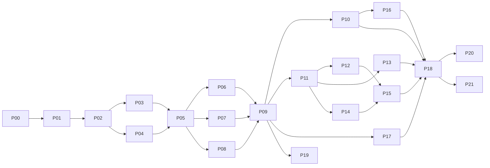

# Refactor status

> Read [README.md](README.md) first. Update this file at the start and end of every session (on
> `refactor/main`). Statuses: **free**, **in progress (session name)**, **done**, **blocked
> (reason)**.

## Packages

Waves run in order. Inside a wave, packages marked parallel can run at the same time, each in
its own worktree.

| Id  | Package                                                                            | Depends on          | Parallel with               | Status                           |
| --- | ---------------------------------------------------------------------------------- | ------------------- | --------------------------- | -------------------------------- |
|     | **Wave 0: set up**                                                                 |                     |                             |                                  |
| P00 | [Set up the refactor](packages/P00-setup.md)                                       | none                | none                        | done                             |
| P01 | [Delete dead code](packages/P01-dead-code.md)                                      | P00                 | none                        | done                             |
|     | **Wave 1: the basics** (audit R2)                                                  |                     |                             |                                  |
| P02 | [One set of basic types; money](packages/P02-basic-types.md)                       | P01                 | none                        | done                             |
| P03 | [One current-price query](packages/P03-current-price.md)                           | P02                 | P04                         | done                             |
| P04 | [One card-type helper](packages/P04-card-types.md)                                 | P02, decision 1     | P03                         | done                             |
|     | **Wave 2: capabilities and adapters** (audit R3) · milestone 1                     |                     |                             |                                  |
| P05 | [Capability and binding framework](packages/P05-framework.md)                      | P03, P04            | none                        | done                             |
| P06 | [Deck read capabilities](packages/P06-deck-reads.md)                               | P05                 | P07, P08                    | free                             |
| P07 | [Candidate pool and store quote](packages/P07-candidates.md)                       | P05                 | P06, P08                    | free                             |
| P08 | [Deck edits and previews](packages/P08-edits-previews.md)                          | P05                 | P06, P07                    | free                             |
| P09 | [Remaining tools and error text](packages/P09-remaining-tools.md)                  | P06, P07, P08       | none                        | free                             |
|     | **Wave 3: rules as data** (audit R4, R5)                                           |                     |                             |                                  |
| P10 | [Formats as a strategy table](packages/P10-formats.md)                             | P09                 | P11–P14                     | free                             |
| P11 | [Card features: model and storage](packages/P11-card-features.md)                  | P09, decision 3     | P10                         | blocked (decision 3)             |
| P12 | [Mana and casting from features](packages/P12-mana-casting.md)                     | P11                 | P10, P13, P14               | free                             |
| P13 | [Tags, themes and signals](packages/P13-tags-signals.md)                           | P11                 | P10, P12, P14               | free                             |
| P14 | [Lands and draft cards from features](packages/P14-lands-drafts.md)                | P11                 | P10, P12, P13               | free                             |
|     | **Wave 4: merge parallel implementations** (audit R6) · milestone 2                |                     |                             |                                  |
| P15 | [One opening-hand engine](packages/P15-opening-hands.md)                           | P12, P14            | P16, P17                    | free                             |
| P16 | [One mana curve](packages/P16-mana-curve.md)                                       | P10, decision 2     | P15, P17                    | blocked (decision 2)             |
| P17 | [One way to show a collection](packages/P17-collections.md)                        | P09                 | P15, P16                    | free                             |
|     | **Wave 5: structure** (audit R7–R9) · milestone 3 (final)                          |                     |                             |                                  |
| P18 | [Split `decks` by responsibility](packages/P18-split-decks.md)                     | P10–P17, decision 4 | none                        | blocked (decision 4)             |
| P19 | [Break up the deck builder UI](packages/P19-builder-ui.md)                         | P09                 | any of waves 3–4 except P16 | free                             |
| P20 | [Responsibility check for other modules; large files](packages/P20-large-files.md) | P18                 | P21                         | free                             |
| P21 | [Naming sweep and docs](packages/P21-naming-docs.md)                               | P18                 | P20                         | free                             |

## Size tracking

P00's `pnpm sizes` prints these. Add a row when each wave merges. Targets are from doc 65, "The end
state".

| After      | Source lines | Test lines | Files > 500 | Biggest folder | Clone runs | `getContainer()` in app          |
| ---------- | ------------ | ---------- | ----------- | -------------- | ---------- | -------------------------------- |
| Baseline   | 93,361       | 32,194     | 28          | 43             | 83         | 191                              |
| P00 script | 93,490 \*    | 33,860     | 28          | 43             | 63 \*\*    | 191                              |
| **Target** | **≤ 80,000** | —          | **0**       | **≤ 12**       | **≤ 20**   | **one per file, via `action()`** |

## Milestones (`refactor/main` → `main`, user approves)

| Milestone | After  | Requires                                                                | Status      |
| --------- | ------ | ----------------------------------------------------------------------- | ----------- |
| 1         | Wave 2 | full suite green; every LLM tool and builder feature working again      | not reached |
| 2         | Wave 4 | full suite green                                                        | not reached |
| 3         | Wave 5 | full suite green; no file over 500 lines without a reason; docs updated | not reached |

## Decisions needed (ask the user; record the answer here and on the tududi task)

1. (tududi task 260) **Double-faced cards (P04):** does a spell with a land on its back count as a land for the
   deck's land count, the drafter and test hands? Today the builder says no and the drafter says
   yes. **Answered (2026-11-19): yes.** A double-faced card with a land face counts as a land
   everywhere: the deck's land count, the drafter and test hands.
2. (tududi task 261) **The mana curve (P16):** should everything share one curve (the builder's 0–7+), or should
   the drafter and "draft a deck" keep their own named versions?
3. (tududi task 262) **Card features storage (P11):** precompute at sync (needs a backfill) or compute when a deck
   loads and cache it?
4. (tududi task 263) **Splitting `decks` (P18):** four modules (`decks`, `deck-play`, `deck-advice`, `proxies`), or one `decks/` module with
   four responsibility subfolders, the way `research/` holds `reddit/` and `youtube/`?
5. (tududi task 264) **The 27 unregistered tools (P01):** any to bring back as bindings after P09?

## Decisions made

| #   | Decision                                                                                                        | Date       |
| --- | --------------------------------------------------------------------------------------------------------------- | ---------- |
| —   | Work on branches; `refactor/main` may break; features are rebuilt; tests are rewritten for the new design       | 2026-11-18 |
| —   | 500 lines per file is the benchmark: over it needs a reason on the allowlist                                    | 2026-11-18 |
| —   | Lessons are deferred to the backlog; packages don't write lessons                                               | 2026-11-18 |
| —   | No feature is removed on purpose; only redundant code (duplicates, dead code, two implementations of one job)   | 2026-11-18 |
| —   | Layout is by responsibility: one responsibility per module, layer folders inside (ADR 0001); no feature folders | 2026-11-18 |

## Broken right now (on `refactor/main`)

| What's broken | Broken by | Fixed by | Notes |
| ------------- | --------- | -------- | ----- |
| (nothing yet) |           |          |       |

## Backlog

- **Lessons for the refactor**, to plan after the refactor (or between milestones). It's on
  tududi's inbox (ProxyLib account, 2026-11-18). Candidate topics: characterization tests and
  reference outputs; `as const` arrays as the single source for types and schemas; SQL fragments
  as functions; ratchets for gradual cleanup; ports and adapters end to end (one capability, many
  callers); presenters that shape output for a reader; exhaustive error mapping with `assertNever`;
  the strategy pattern with `Record<K, ...>` and `satisfies`; "parse, don't validate" and
  versioned derived data; plugin registries; telling accidental duplication from essential
  similarity; bounded contexts and public API width; `useReducer`; working on long-lived
  branches.

## Tududi

The refactor is tududi project **"Refactor: audit and consolidation (doc 65)"** (uid
`saajqvk9drbreic`, ProxyLib account), with one task per package, each named `Pnn. …` and tagged
`refactor`. When a package changes status here, change its task too: in progress when started,
done when merged into `refactor/main`.

\* includes the P00 scripts (about 130 lines). \*\* a different counting method from the audit's 83: compare later runs with 63.
